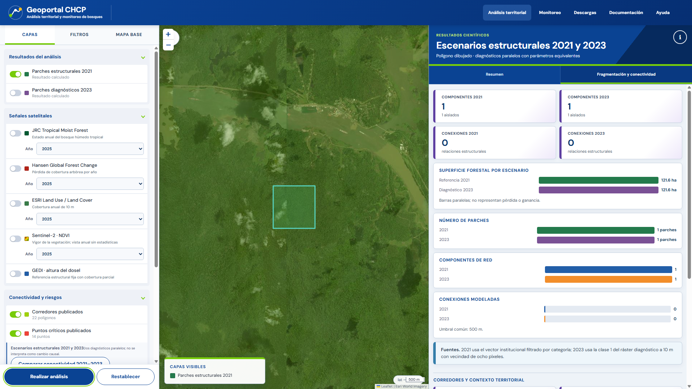
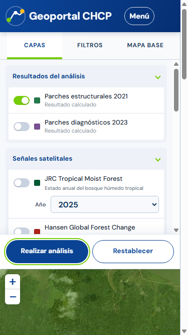

# Geoportal de Conectividad Ecológica de la Cuenca Hidrográfica del Canal de Panamá

Repositorio independiente del geoportal para la **Cuenca Hidrográfica del Canal
de Panamá (CHCP)**. La aplicación integra evidencia satelital, cobertura forestal,
fragmentación, conectividad estructural, corredores publicados y el Índice de
Resiliencia Ecológica (ERI) para apoyar preevaluaciones territoriales reproducibles.

El proyecto conserva el historial de desarrollo del visor original hasta la versión
V2, pero desde este punto evoluciona de forma autónoma. No sustituye una evaluación
de campo, no certifica cumplimiento normativo y no demuestra conectividad funcional
o movimiento de especies.

La aplicación principal es un geoportal web en **HTML, CSS y JavaScript**, servido
por una API **Flask** que reutiliza los motores científicos Python. Un único
asistente permite escoger cuatro rutas explícitas:

1. **Preevaluación territorial:** cinco señales e índice territorial, sin preparar parches.
2. **Fragmentación:** cobertura institucional 2021 y métricas de parches.
3. **Conectividad:** red estructural, aislamiento, brechas y contexto de corredores.
4. **Análisis integral:** presenta primero la preevaluación y añade después la
   estructura, sin mezclar sus fórmulas.

Después de elegir la ruta, el área pública puede ser un polígono dibujado, una
subcuenca local o toda la cuenca. Las geometrías de cuenca y subcuencas viajan con
la aplicación y no dependen de un asset vectorial privado de Earth Engine.

La aplicación produce una **preevaluación indicativa**: ayuda a justificar por qué un
área merece una revisión más detallada y dónde conviene mirar primero. No confirma
hallazgos en campo, no es una certificación, no determina cumplimiento EUDR y no
demuestra por sí sola conectividad funcional para una especie.

## Aplicación principal: web HTML y API Python

La interfaz de `webapp/` está construida con HTML, CSS, JavaScript, Leaflet y Flask.
`app.py` conserva la aplicación Streamlit únicamente como respaldo histórico. Los
cálculos no se ejecutan en el navegador: la API llama directamente a los motores
Python existentes y mantiene caché por área y parámetros.

```powershell
$env:GEE_PROJECT_ID = "geoportal-513817"
python -m webapp.main
```

Abra `http://127.0.0.1:8080`. Para cambiar el puerto, defina `PORT` antes de iniciar.

En Windows también puede hacer doble clic en `ABRIR_GEOPORTAL.cmd`. El iniciador
levanta la aplicación en el puerto 8090, comprueba que responda y abre el navegador
normal del equipo. Esto evita la limitación de los navegadores internos que no pueden
acceder al `localhost` de Windows.

Consulte [la arquitectura web](docs/ARQUITECTURA_WEB_HTML.md),
[la comparación visual](docs/COMPARACION_VISUAL_WEB_HTML.md) y
[la preparación de seguridad y Cloud Run privado](docs/FASE6_SEGURIDAD_CLOUD_RUN_PRIVADO.md).
La [matriz de trazabilidad multifuente](docs/FASE7_MATRIZ_TRAZABILIDAD.md) distingue
fuentes operativas, parciales y pendientes; la
[metodología de integración JRC–ESRI](docs/FASE7_INTEGRACION_MULTIFUENTE.md) documenta
el período común, las máscaras y la concordancia sin fusionar productos.

La Fase 7 añade búsqueda tolerante sobre la CHCP y sus 53 subcuencas, un Panel
territorial que no inventa indicadores pendientes, y una tercera modalidad de
análisis que ejecuta JRC y ESRI por separado y compara coincidencias y diferencias.

La versión de cierre local añade una **comparación estructural 2021–2023**. Ejecuta
la cobertura oficial vectorial 2021 y el diagnóstico raster 2023 como escenarios
separados con idénticos parámetros de fragmentación y conectividad. Debido a sus
diferencias metodológicas, no calcula una transición causal ni presenta la diferencia
de hectáreas como pérdida o ganancia. Consulte [la metodología](METODOLOGIA.md) y
[la auditoría funcional](docs/AUDITORIA_FUNCIONAL.md).

## Módulos científicos y funcionales

- Navegación web entre **Análisis territorial**, **Monitoreo**, **Descargas**,
  **Documentación** y **Ayuda**. Las páginas explicativas no inician Earth Engine.
- Plataforma científica de tres columnas: controles y capas a la izquierda, mapa
  Leaflet permanente en el centro y resultados verificables a la derecha. Las
  pestañas del resultado solo reorganizan la lectura y no vuelven a ejecutar el motor.
- Panel de fuentes inspirado en visores ambientales: JRC TMF, Hansen, ESRI, NDVI y
  GEDI conservan controles independientes, además de los bloques de corredores y
  bosque/conectividad.
- El mapa permite seleccionar el área, activar capas y crear la preevaluación. Después
  mantiene el mapa visible y presenta a la derecha la **Lectura** y las **Gráficas** del
  área, evitando una sección «Análisis» vacía o duplicada.
- El panel gráfico compara aportes por fuente y superficies con indicios; para
  conectividad muestra corredores, bosque y fragmentos cercanos o separados. Las
  barras usan colores consistentes, muestran el valor junto a cada categoría y
  ofrecen también sus valores en tabla.
- Gráficas temporales solicitadas bajo demanda para JRC, Hansen, ESRI y NDVI. GEDI se
  presenta como distribución de altura del dosel, porque no constituye una serie anual
  comparable.
- Pantalla inicial con tres opciones: preevaluación territorial, corredores y conectividad,
  o preevaluación integral.
- Explicación diferenciada para dos niveles de lectura: recorrido breve y lenguaje
  cotidiano para personas no especialistas; fuentes, pesos, umbrales y limitaciones
  bajo demanda para usuarios geoespaciales.
- Selección pública mediante polígonos editables, las 53 subcuencas locales o la
  cuenca completa. El polígono que cruza la CHCP se recorta a su intersección válida.
- Catálogo temporal en `geoportal_catalogo.py`, con años válidos por fuente y
  rechazo explícito de períodos inexistentes. GEDI, bosque 2021 y ERI se identifican
  como productos de referencia fija, no como falsas series anuales.
- Motor temporal científico en **Comparar**: recupera cobertura bosque/no bosque de
  JRC TMF o ESRI para dos años y recalcula fragmentación y conectividad con parámetros
  equivalentes. Ambas metodologías permanecen separadas.
- Comparación diagnóstica 2021–2023 mediante `/api/v1/structural-comparison`, con
  mapas, métricas y PDF independientes por escenario y una advertencia explícita de
  no causalidad.
- 22 polígonos de corredores y 14 puntos críticos publicados por Almanaque Azul.
- Las categorías originales `alta`, `mediana` y `media-baja`, sin sustituirlas por una clasificación inventada.
- Los tres tramos panameños identificados como Corredor Biológico Mesoamericano: oeste, San Lorenzo y este.
- Intersección del área evaluada con corredores, medida en hectáreas mediante un sistema equivalente en área.
- Lectura automática del recorte vectorial de **Bosque y otros usos 2021** desde un asset privado de Earth Engine.
- Métricas de fragmentación equivalentes a las utilizadas en los ejercicios R: número y densidad de parches, área total/media/mediana, borde, forma y parche mayor.
- Red de parches conectados por una distancia configurable e índice conector compuesto por grado (40%), intermediación (30%), área (20%) y fuerza de conexión (10%).
- Red completa para las métricas y una estructura mínima legible en el mapa, trazada entre los bordes más próximos de los fragmentos.
- Ruta estructural potencial hacia un corredor publicado cuando existe una cadena de bosque en la que cada salto cumple la distancia seleccionada; la búsqueda usa el contexto necesario según la distancia al corredor y nunca supera 5 km.
- Capa visual opcional de cobertura completa de bosque 2021 dentro del área y el contexto adaptativo calculado, sin sumar el exterior a las hectáreas del resultado.
- Brechas potenciales desde parches aislados hacia su vecino más cercano; las capas se pueden consultar y descargar como GeoJSON.
- Resultados de corredores y fragmentación en la interfaz, el PDF y el registro metodológico JSON.
- Diagnóstico de visita que combina la urgencia por cambios con el valor estratégico
  del corredor y usa la estructura del bosque 2021 para indicar dónde focalizarla.
- Experiencia con divulgación progresiva: muestra primero la acción, la conclusión y el
  mapa; los cálculos, gráficos, tablas, fuentes y descargas permanecen disponibles como
  detalles opcionales, sin eliminar información del análisis.
- Comparador temporal con un divisor de 44 px que puede arrastrarse con mouse o
  pantalla táctil y mantiene ambos años sincronizados al acercar, alejar, mover o
  ampliar el mapa a pantalla completa.
- Ficha PDF ejecutiva con puntaje desglosado y dos mapas sin fondo satelital: uno
  para explicar la fragmentación y otro para mostrar la conectividad estructural y
  la ruta potencial hacia un corredor de referencia. Las leyendas quedan fuera del
  mapa y la evidencia técnica permanece al final.

El índice satelital de cambios integra JRC, Hansen, ESRI, GEDI y una señal
corroborativa de disminución NDVI 2020-2025, con un máximo de 6.5 puntos. NDVI
aporta como máximo 0.5 y exige extensión, proporción y cobertura válida mínimas.
La prioridad de visita conserva este índice como componente dominante y añade
hasta 1.5 puntos de valor estratégico: hasta
1.0 por la proporción del área dentro de corredores y 0.5 por pertenencia al
Corredor Biológico Mesoamericano. Un corredor sin señales suficientes de cambio
nunca genera por sí solo una prioridad alta. La fragmentación no recibe un peso
inventado: clasifica la condición estructural y dirige la revisión hacia parches
conectores, separaciones y componentes aislados.

## Flujo de uso

1. Consulte **Documentación** o **Ayuda** cuando necesite revisar fuentes, alcance o limitaciones; estas páginas no ejecutan Earth Engine.
2. Abra **Análisis territorial** y dibuje un polígono, seleccione una subcuenca o use toda la cuenca configurada.
3. En el asistente seleccione uno o varios componentes entre **Preevaluación territorial**, **Fragmentación** y **Conectividad**. **Análisis integral** selecciona los tres y es excluyente para evitar cálculos duplicados.
4. Active solo las capas cartográficas que necesite y pulse **Realizar análisis**. Las capas modifican la visualización; los componentes del asistente determinan qué motores se ejecutan. La aplicación presenta primero la lectura territorial y prepara parches o red solo cuando se solicitaron.
5. En las opciones con conectividad, la aplicación conserva el área elegida para las hectáreas, pero revisa también un
   entorno exterior adaptativo de hasta 5 km para evitar falsos aislamientos y buscar una cadena
   estructural hacia un corredor publicado.
6. Use **Capas disponibles en el mapa** para encender o apagar por separado la
   cobertura completa de bosque del área y su entorno, los fragmentos evaluados,
   la estructura esencial, la ruta potencial hacia un corredor y las separaciones.
   La ruta naranja es una orientación estructural para revisar, no un corredor nuevo
   ni evidencia de movimiento de fauna. El bosque exterior que se muestre no se suma
   a las hectáreas informadas para el polígono.
7. Consulte en la columna derecha **Resumen**, **Dinámica del bosque**,
   **Fragmentación y conectividad** o **Coberturas oficiales** sin abandonar ni
   recargar el mapa. Corredores y contexto territorial forman parte de la lectura de
   conectividad; interpretación, limitaciones e informe se despliegan dentro del
   resumen para no crear pestañas independientes sin contenido principal.
8. En la preevaluación territorial o integral, prepare la ficha PDF. La primera página explica el puntaje y la acción; las dos
   siguientes separan fragmentación y conectividad para evitar que las líneas oculten
   el patrón del bosque.

## Fuentes

- JRC Tropical Moist Forest 2025.
- Hansen Global Forest Change 2025.
- ESRI Land Use/Land Cover 2017-2025 para consulta visual; el índice conserva
  el período metodológico validado 2017-2024.
- GEDI / OpenForis para altura del dosel.
- Sentinel-2 SR Harmonized para NDVI.
- [Mapa de corredores naturales de Panamá](https://www.almanaqueazul.org/conectividad/mapa/), Fundación Almanaque Azul, versión mostrada `2024.05`.
- SINIA–MiAMBIENTE, capa **Bosque y otros usos**, referencia 2021. El recorte de bosque se conserva como asset institucional privado y no se almacena en Git.

La procedencia de los GeoJSON incluidos se documenta en [THIRD_PARTY_DATA.md](THIRD_PARTY_DATA.md).
El inventario de assets está en [docs/CATALOGO_DATOS.md](docs/CATALOGO_DATOS.md), la
arquitectura actual en [docs/ARQUITECTURA.md](docs/ARQUITECTURA.md) y la instalación
reproducible en
[docs/INSTALACION_Y_REPRODUCCION.md](docs/INSTALACION_Y_REPRODUCCION.md).

## Evidencia visual local

Las siguientes capturas proceden de la aplicación Flask real y de un resultado
calculado con `geoportal-513817`; no son maquetas ni contienen valores inventados.





El recorrido, las métricas, las pruebas y las limitaciones están registrados en
[docs/AUDITORIA_FUNCIONAL.md](docs/AUDITORIA_FUNCIONAL.md).

## Instalación y ejecución local

Requiere Python 3.11 o superior.

```powershell
git clone https://github.com/julii5sos/geoportal-chcp-conectividad-ecologica.git
cd geoportal-chcp-conectividad-ecologica
python -m venv .venv
.\.venv\Scripts\Activate.ps1
# Entorno completo, incluida la aplicación Streamlit histórica:
python -m pip install -r requirements.txt

# Para instalar únicamente la aplicación Flask/API actual use, en su lugar:
# python -m pip install -r requirements-web.txt
$env:GEE_PROJECT_ID = "geoportal-513817"
python -m webapp.main
```

Abra `http://127.0.0.1:8080`. La alternativa histórica puede iniciarse con
`streamlit run app.py`, pero no es la interfaz principal del repositorio.

## Estado de publicación

Todavía no existe un despliegue de producción autorizado. La arquitectura preparada
para una publicación privada es el contenedor Flask en Google Cloud Run, con
Application Default Credentials y sin claves JSON dentro de la imagen. Streamlit
se conserva como respaldo y no define la presentación actual del geoportal.

El archivo `conectividad_canal.zip` se utilizó como referencia de identidad visual.
Los análisis científicos permanecen implementados en Python y Google Earth Engine;
el ERI conserva su carácter complementario y no modifica la prioridad territorial.

## Configuración de Earth Engine

El proyecto de cuota configurado por defecto es `geoportal-513817`. Puede
declararlo explícitamente mediante la variable de entorno `GEE_PROJECT_ID`. El alias
anterior `EE_PROJECT` se acepta solo para facilitar la migración.

Para desarrollo local autentique de forma explícita la cuenta de Google que
corresponda. Las credenciales OAuth permanecen fuera del repositorio:

```powershell
$env:GEE_PROJECT_ID = "geoportal-513817"
earthengine authenticate --force --auth_mode=localhost
python scripts/verificar_conexion_gee.py --project geoportal-513817 --jrc
```

En Cloud Run configure `GEE_PROJECT_ID=geoportal-513817` y asigne al servicio una
cuenta con acceso mínimo a Earth Engine y lectura de los assets requeridos. No cree
ni incluya claves JSON; el servidor utiliza Application Default Credentials.

### Cobertura institucional 2021

El motor utiliza por defecto
`projects/geoportal-513817/assets/SINIA_2021_COBERTURA_GENERAL_VECTOR`. El 7 de
noviembre de 2026 se comprobó con Earth Engine que es una `FeatureCollection`, que
contiene el campo `Categoria` y la clase exacta
`Bosques y Otras Tierras Boscosas`. Una prueba sobre Qda. Bonita produjo cobertura,
seis parches y una red de nueve aristas con el motor original. La identidad que
ejecutó la prueba pudo leer el asset sin depender del proyecto personal anterior.

La equivalencia temática de la clase y la compatibilidad funcional con el motor
quedaron verificadas. No puede afirmarse igualdad entidad por entidad frente al
asset antiguo porque ese identificador ya no existe. El identificador puede
sobrescribirse, sin modificar código, mediante `SINIA_2021_FOREST_ASSET`.

Desde ese momento, cada área seleccionada usa la misma fuente: la aplicación filtra internamente `Categoria = Bosques y Otras Tierras Boscosas`, conserva el recorte del área activa para las hectáreas y usa un contexto exterior adaptativo —distancia al corredor más cercano más el umbral, con máximo de 5 km— para calcular la red y buscar una conexión estructural potencial. No muestra un cargador ni un selector de clases.

## Estructura principal

- `webapp/`: interfaz HTML/Leaflet, API Flask, controles, caché y seguridad.
- `app.py`: punto de entrada histórico de la alternativa Streamlit.
- `app_temporal.py`: controles, mapas, gráficas y descargas del análisis temporal.
- `analisis_temporal.py`: recuperación anual, vectorización, transiciones y ejecución
  independiente de las dos redes.
- `app_experiencia.py`: interfaz cartográfica, motor Earth Engine e informe.
- `portal_html.py`: encabezado, portada y composición visual copiados del HTML de referencia.
- `geoportal_catalogo.py`: disponibilidad, versión y reglas temporales de las fuentes.
- `geoportal_componentes.py`: panel, mapa y controles territoriales reutilizables para el
  estado local sin Earth Engine; mantiene el mapa útil y evita resultados simulados.
- `territorio_local.py`: carga de la cuenca y las 53 subcuencas desde GeoJSON locales.
- `corredores.py`: capas de Almanaque Azul e intersección con el área evaluada.
- `bosque_conectividad.py`: preparación del recorte institucional, fragmentación y red de parches.
- `metodologia_indice.py`: reglas del índice satelital original.
- `scripts/preparar_datos_corredores.py`: conversión reproducible EPSG:3857 → EPSG:4326.
- `data/territorio/`: cuenca y subcuencas incluidas en el portal, sin depender de un asset de Earth Engine.
- `data/`: GeoJSON preparados, catálogo y originales públicos.
- `METODOLOGIA.md`: fórmulas, separaciones metodológicas y limitaciones.
- `docs/COMPARACION_VISUAL_GEOPORTAL_CHCP_V2.md`: contraste verificable con el HTML,
  capturas locales, desviaciones deliberadas y alcance real de la comparación temporal.

## Pruebas

```powershell
python -m unittest discover -v
```

La suite incluye pruebas unitarias, funcionales y científicas con geometrías sintéticas.
Las pruebas de integración que consultan Earth Engine se habilitan de forma explícita
con `RUN_EE_INTEGRATION=1` y requieren un proyecto de Earth Engine autorizado.

## Análisis temporal

La sección **Comparar** recalcula cobertura forestal, fragmentación y conectividad
estructural para dos años válidos. JRC TMF es la fuente principal; ESRI se ofrece como
alternativa independiente. NDVI, GEDI, Hansen, ERI y la cobertura institucional 2021 no
se presentan como coberturas anuales intercambiables.

Consulte la [metodología y sus limitaciones](docs/METODOLOGIA_ANALISIS_TEMPORAL.md) y
el [ejemplo reproducible JRC 2020–2025](docs/VALIDACION_JRC_2020_2025.md).

## Auditoría de la versión candidata

- [Informe general de Fase 5](docs/AUDITORIA_FINAL_FASE5.md)
- [Auditoría de Sentinel-2 y Dynamic World](docs/AUDITORIA_COBERTURA_SENTINEL2.md)
- [Validación de fragmentación y conectividad](docs/VALIDACION_FRAGMENTACION_CONECTIVIDAD.md)
- [Verificación metodológica del ERI](docs/VERIFICACION_ERI.md)

## Rendimiento y límites prácticos

El asset se recorta primero en Earth Engine usando el área activa más su buffer de contexto adaptativo y se generaliza a 10 m antes de transferirse. El resultado se procesa en memoria, pero solo las porciones interiores se publican en el mapa y en las métricas de superficie. Para áreas con miles de fragmentos, aumente el área mínima de parche. A partir de 250 nodos, la intermediación se aproxima con una muestra reproducible de hasta 64 nodos para evitar bloquear la aplicación; la cercanía, que no participa en el índice, se omite en esas redes grandes.
