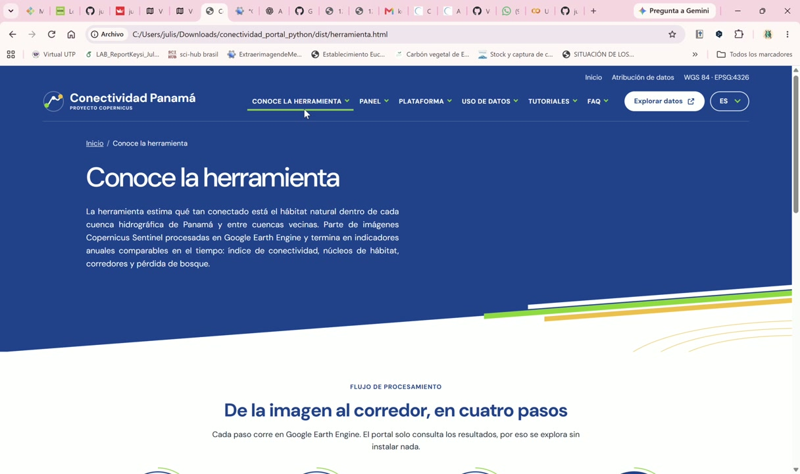
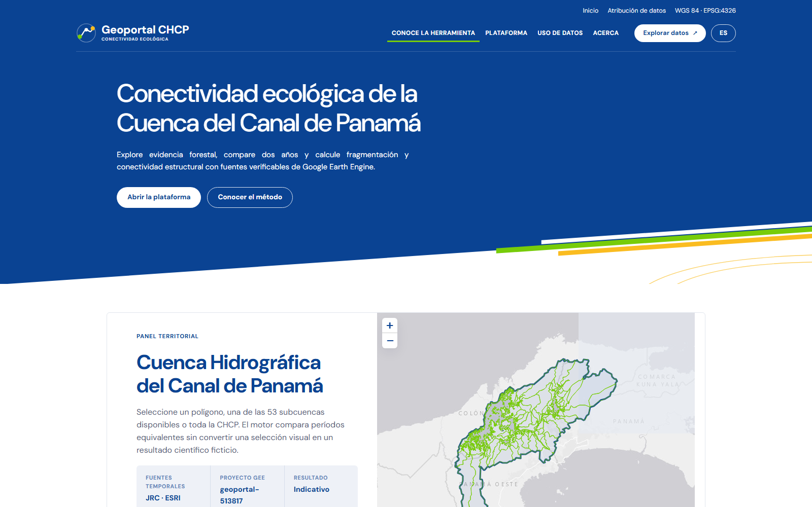
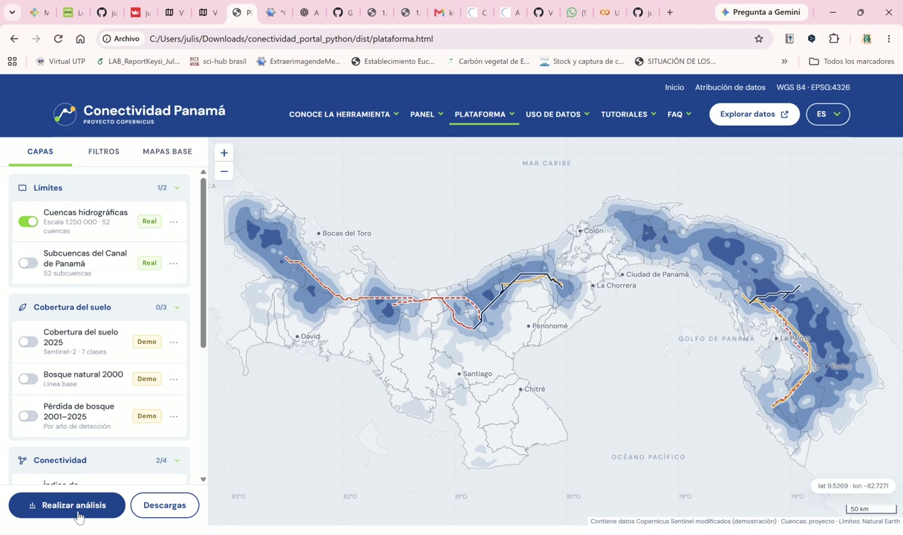
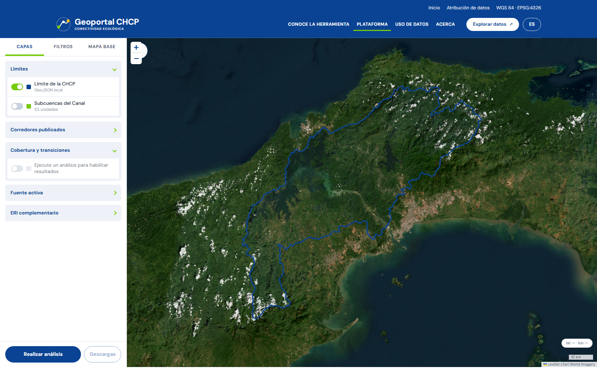
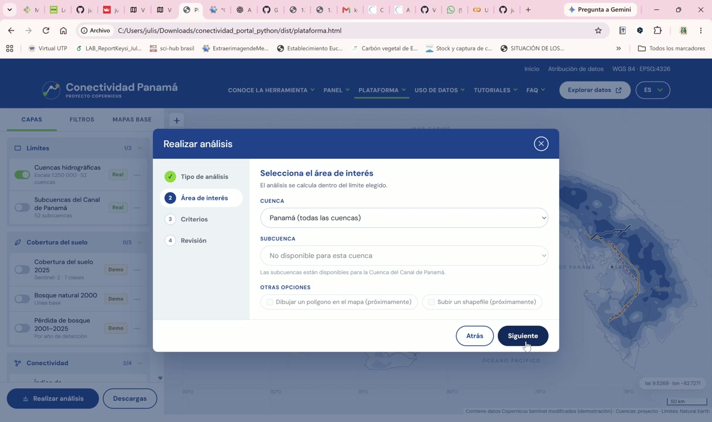
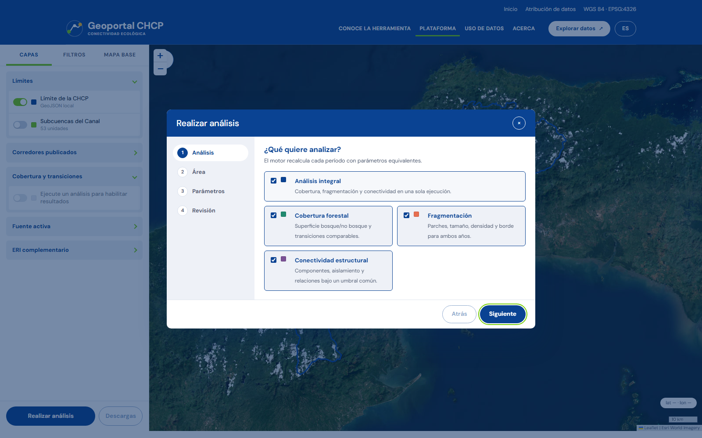
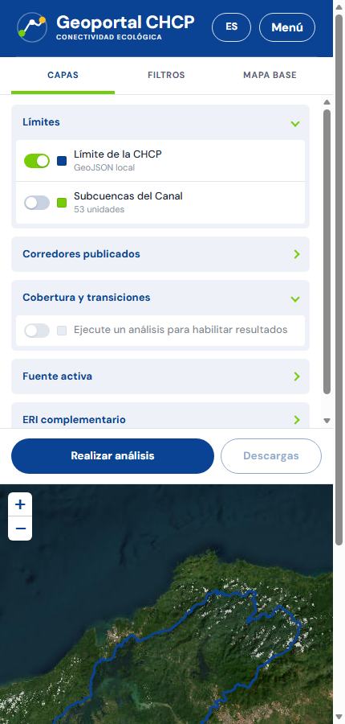

# Comparación visual · HTML original y versión web científica

La identidad se tomó del HTML original. El video se utilizó para comprobar el orden
de interacción y la aparición de paneles. Las capturas nuevas proceden del servidor
Flask local real en `http://127.0.0.1:8080`; no son maquetas.

## Portada

| Referencia original | Versión web actual |
|---|---|
|  |  |

Se conservaron el encabezado azul de dos niveles, navegación horizontal, DM Sans,
hero diagonal, líneas verde/amarilla y resumen territorial. El contenido se adaptó a
las fuentes y al motor reales del Geoportal CHCP.

## Explorador cartográfico

| Referencia original | Versión web actual |
|---|---|
|  |  |

La versión actual mantiene un panel izquierdo de 340 px con `Capas`, `Filtros` y
`Mapa base`, un mapa central sin scroll vertical y botones fijos de análisis y
descarga. Los límites, subcuencas, 22 corredores y 14 puntos críticos proceden de
GeoJSON locales. El panel derecho aparece únicamente después de un resultado real.

## Asistente de cuatro pasos

| Referencia original | Versión web actual |
|---|---|
|  |  |

El paso inicial permite cobertura, fragmentación, conectividad o análisis integral.
Los pasos siguientes resuelven área, fuente/años/parámetros y revisión. El botón
final llama al motor Python; no cambia solo la apariencia del mapa.

## Vista móvil

En 430 px el panel, los tres tabs y ambos botones permanecen dentro del viewport. El
mapa se coloca debajo del panel y conserva zoom táctil. El flujo usa los mismos
controles y no introduce una versión científica distinta.

## Diferencias conscientes pendientes

- Los iconos se redujeron a SVG/CSS propios y controles Leaflet; no se copiaron
  bibliotecas decorativas del prototipo.
- El panel derecho no muestra cifras hasta completar un cálculo real. El HTML original
  incluía resultados demostrativos preparados con anterioridad.
- La versión móvil prioriza primero el panel de selección y luego el mapa; en una fase
  pública podría añadirse un botón flotante para alternarlos sin scroll.
- La comparación de resultados reales se validó por API. No se repitió una segunda
  ejecución pesada solo para producir una captura, de acuerdo con la optimización
  solicitada.

